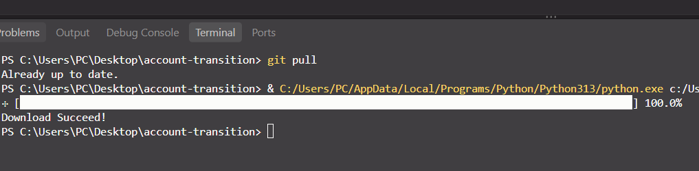

# Hi there! This repo will mostly focus on Pyhon.
I will be uploading some of my codings here, such as practicing, learning, or taking note...   
And most importantly, this is also a look back for myself, as well as a progress and a journal of mine.   
Lastly, I will update as soon as I have time to push! And don't forget to check out my blog! ^^    
This is my blog ---> [My-Blog](https://mike-asdf1346.github.io/)   
   
## 1. 酷酷的進度條

可惜我沒辦法用影片QQ   
code:   
```
from time import sleep as t
n = 100 
icon = "⁛⁛⁘⁘⸭⸭"
for i in range(1, n + 1):
    print(f"\r{icon[i % 6]} [{"█" * (i - 1)}{" " * (n - i)}] {round(i * 100 / n, 1)}%", end=" ", flush=True)
    t(0.1)
print("\nDownload Succeed!")
```   
   
## 2. TODO
